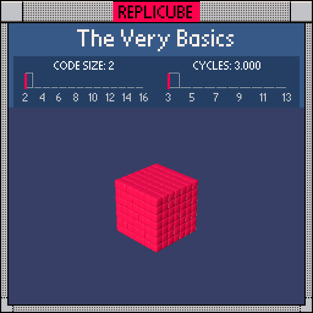

# Tutorial Projects

This folder contains my solutions to the "Tutorial Projects" project provided by
Replicube, in order to get familiar with how the game works.

| Challenge                                         | Best Size | Best Cycles  | Image(s)                                          |
|----------------------------------------------|-----------|--------------|---------------------------------------------------|
| [The Very Basics](./001-the-very-basics.lua) | `2` (#1)  | `3.000` (#1) |  | 
